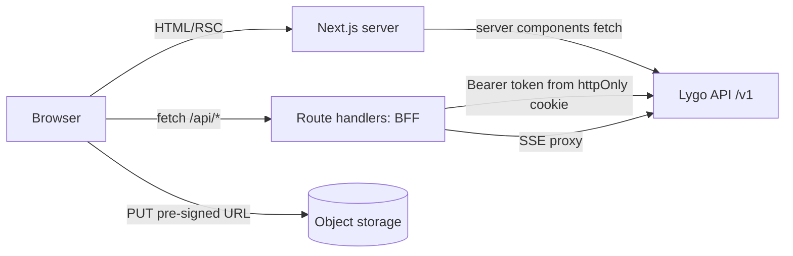

# 02 — Architecture



- **Backend-for-frontend (BFF)**: `src/app/api/*` route handlers hold tokens in httpOnly cookies,
  refresh them, and proxy requests to the API. The browser never sees access tokens.
- **Server Components** fetch initial data for pages; **Client Components** use TanStack Query
  for interactive data, mutations and polling.
- **Uploads** go straight from the browser to storage with pre-signed URLs from the API, then the
  client confirms the upload; large scans never pass through the Next.js server.
- **Streaming chat** uses SSE through the BFF.
- **Typed client**: `src/lib/api/schema.ts` generated from the backend OpenAPI with
  `openapi-typescript`; `src/lib/api/client.ts` wraps it with tenant-aware helpers.

## Feature module pattern

```
src/features/documents/
  api.ts          query/mutation hooks (useClientDocuments, useUploadDocument…)
  components/     DocumentList, DocumentViewer, UploadDropzone, ProcessingTimeline
  schemas.ts      zod schemas for forms
  types.ts
```

Pages in `app/` compose feature components; features don't import from each other's internals.
